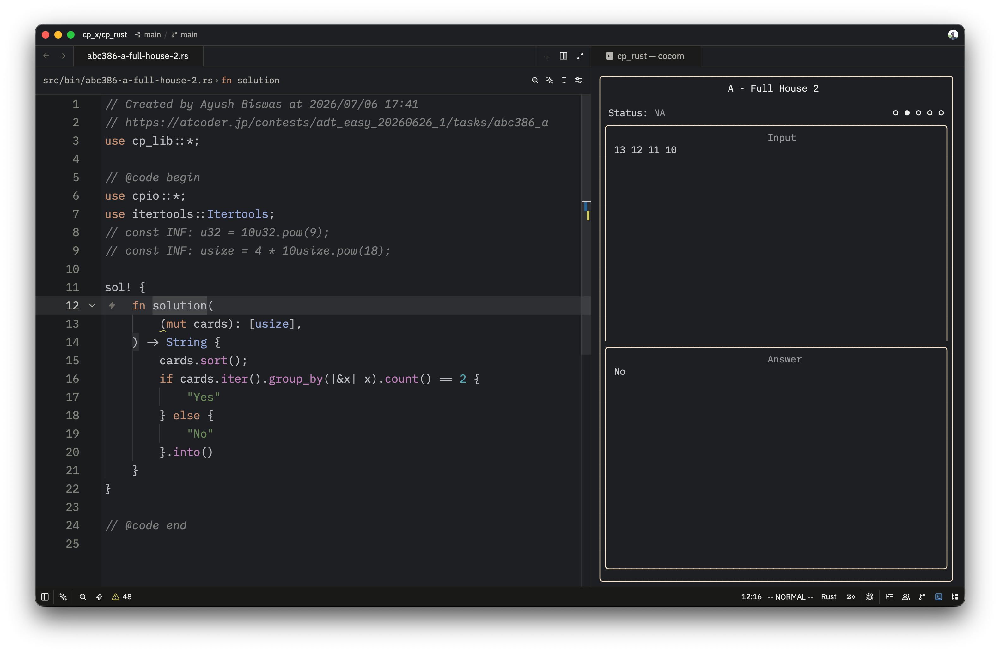

<div align="center">

# ⚒️ Eitri

</div>

### Forge your solutions. A competitive programming companion for the terminal.

[](LICENSE)

In Marvel lore, Eitri is the dwarf king who forged Stormbreaker. This tool does the same job for your contest solutions: it takes a raw problem from the browser, sets up your workspace, links your personal library into one submittable file, and tests it against the samples, all without leaving the terminal.

Eitri works with the [Competitive Companion](https://github.com/jmerle/competitive-companion) browser extension, so a single click on a problem page is enough to get started.

---

## Features

- **Problem intake**: a local HTTP server (`127.0.0.1:6174`) receives problem metadata, constraints, and sample tests from the browser extension.
- **Smart file routing**: maps problem URLs to directories and filenames using regex captures and Go templates, so every site gets its own naming scheme.
- **Boilerplate generation**: creates your starter file from a template, with author, timestamp, and problem URL filled in.
- **Snippet linker**: reads `@head` and `@code` tags in your personal library, sorts dependencies topologically, and merges everything into the final submission. Cyclic dependencies are detected and rejected.
- **Watch and run**: a filesystem watcher compiles and runs your code against the samples every time you save.
- **Sandboxed execution**: code compiles and runs in an isolated temporary directory with strict time limits and peak memory tracking.
- **Transpiled-language support**: if your language compiles to another one (ClojureScript to JavaScript, for example), Eitri can copy and submit the compiled output instead of your source file.
- **Split-pane TUI**: a Bubble Tea interface for comparing input, expected output, actual output, and stderr side by side, with mouse support.
- **Switchable layout**: flip the panes between side-by-side and stacked on the fly to fit your terminal and workflow.
- **Strict config validation**: `eitri.yml` is validated on startup, so mistakes are caught early instead of failing halfway through a contest.
- **Silent logging**: structured logs go to a file in the OS temp directory, so debugging never clutters the interface.

---

## Demo

> *Preview with Zed*



> Tip: press `f` to switch to the editor.

> *Example workflow using Neovim*


> *Example workflow using VS Code*


---

## Installation

You need [Go](https://go.dev/dl/) 1.22 or newer.

```
go install github.com/veryshyjelly/eitri@latest
```

---

## Quick start

1. Run `eitri` in the root of your competitive programming workspace.
2. If no `eitri.yml` exists, Eitri offers to generate a starter config. Edit it to match your language and folder layout.
3. Open a problem in your browser and click the Competitive Companion button.
4. Eitri receives the problem, creates your file, and opens it in your editor.
5. Save the file. Your tests run automatically.
6. Press `c` to copy the final linked solution, then submit it.

---

## Usage

```
eitri [options]
```

| Flag                    | Description                     | Default           |
| ----------------------- | ------------------------------- | ----------------- |
| `-c`, `--config <file>` | Path to the configuration file. | `./eitri.yml`     |
| `-C`, `--root <dir>`    | Project root directory.         | `.` (current dir) |
| `-d`, `--debug`         | Enable verbose debug logging.   | `false`           |
| `-v`, `--version`       | Show version information.       | `false`           |
| `-h`, `--help`          | Show help message.              | `false`           |

---

## Configuration (`eitri.yml`)

If `eitri.yml` is not found, Eitri offers to generate a starter template. Here is an example for **OCaml**:

```yaml
author: YOUR_NAME_HERE

# Command to open the generated file in your editor
editor: "code {{ .Filename }}"

# Rules for generating filenames from problem URLs
filename:
  rules:
    - site: codeforces.com
      regex: "(?:problemset/problem|contest|gym)/(\\d+)(?:/problem)?/([A-Za-z0-9]+)"
      template: './src/bin/{{ index .Captures 1 }}-{{ index .Captures 2 }}-{{ .Title | stripPrefix "." | toKebabCase }}.ml'

    - site: atcoder.jp
      regex: "contests/([^/]+)/tasks/([^_]+)_([a-z]+)"
      template: './src/bin/{{ index .Captures 2 }}-{{ index .Captures 3 | toLowerCase }}{{if gt (.Title | stripPrefix "-" | len) 0}}-{{ .Title | stripPrefix "-" | toKebabCase }}{{- end -}}.ml'

# Base template for newly created files
template:
  source: ./src/main.ml
  modifier: |
    (* Created by {{ .Author }} at {{ .Time }}
       {{ .Url }} *)
    {{ .Code }}

# Post-processor for the final submitted code
code:
  modifier: |
    {{ .Header }}
    {{ range .LibFiles }}
    (* --- {{ .Name }} --- *)
    {{ .Content }}
    {{ end }}
    {{ .Code }}

# Custom library linking
lib:
  # Regex template to detect library usage in code
  regex: "open {{ .Name }}"
  include:
    dsu: "./src/lib/dsu.ml"
    math: "./src/lib/math.ml"

# Compiler and execution settings
compiler:
  name: Ocaml
  source: "main.ml"       # Name of the sandbox file
  compile: ocamlfind      # Leave empty for interpreted languages (Python, etc.)
  args:
    - ocamlopt
    - -O2
    - -o
    - a.out
    - main.ml
    - -linkpkg
    - -thread
    - -package
    - str,num,zarith,threads,containers,core,iter,batteries
  run: ./a.out

# Behavior toggles
create_file: true   # Auto-create boilerplate when a problem arrives
run_on_save: true   # Auto-run tests when the watcher detects changes
```

### Submitting transpiled output

By default, Eitri copies and submits your source file. If your language is transpiled, set `compiled_file` to the file your build step produces, and Eitri will copy and submit that file instead.

Here is a **ClojureScript** setup that compiles to JavaScript:

```yaml
compiler:
  name: Clojurescript
  source: main.cljs
  compile: build-clj.sh   # assumed to compile main.cljs and produce main.js
  args:
    - ./main.cljs
  run: bun run ./main.js

# The file to copy and submit after compilation
compiled_file: main.js
```

Tests still run through `run`, so you test exactly what you will submit.

### Config validation

Eitri validates `eitri.yml` strictly when it starts. If a field is missing or invalid, you get an error right away rather than a confusing failure mid-run.

---

## Keybindings

| Keys                   | Action                        |
| ---------------------- | ----------------------------- |
| `r` / `Ctrl+'`         | **Run** test cases manually   |
| `f`                    | **Create** boilerplate file   |
| `c`                    | **Copy** solution file        |
| `a`                    | **Add** custom test case      |
| `q` / `Esc` / `Ctrl+C` | **Quit** application          |
|                        |                               |
| `1` / `j`              | View: **Input** & **Answer**  |
| `2` / `k`              | View: **Input** & **Output**  |
| `3` / `l`              | View: **Input** & **Error**   |
| `4` / `;`              | View: **Answer** & **Output** |
|                        |                               |
| `→` / `Tab`            | **Next** test case            |
| `←` / `Shift+Tab`      | **Previous** test case        |
| `?`                    | Toggle **Help** menu          |
|                        |                               |
| `Ctrl+H`               | Panes **side by side**        |
| `Ctrl+V`               | Panes **stacked**             |

Mouse scrolling and clicking also work in the split-pane viewports.

---

## How the linker works

Eitri's linker treats your personal snippet library like a tiny compiler front end:

1. It scans the files listed under `lib.include`.
2. It uses `lib.regex` to build a dependency graph. For example, if `graph.ml` contains `open DSU`, it depends on `dsu.ml`.
3. It runs a **topological sort** (DFS) so dependencies come before the files that need them, and it rejects cycles.
4. It extracts headers (`@head begin` ... `@head end`) and code blocks (`@code begin` ... `@code end`) and merges them into the final solution without touching your local library files.

---

## Logging and debugging

Eitri logs in the background so the interface stays clean.

- **Location**: `<OS_TEMP_DIR>/eitri.log` (for example `/tmp/eitri.log` on Linux and macOS).
- **Levels**: `DEBUG` (enable with `-d`), `INFO`, and `ERROR`.
- **Contents**: incoming HTTP payloads, dependency graph resolution, compiler stderr, and sandbox execution metrics.

---

## Roadmap

These are ideas, not implemented features:

- Stress testing: run your solution against a brute-force one on random inputs to find failing cases.
- Custom checkers for problems with multiple valid answers.
- Per-test time and memory display in the TUI.
- Multiple compiler profiles, switchable per problem or per site.
- Contest mode: track all problems of a contest in one view.

---

## Contributing

Contributions, issues, and feature requests are welcome. See the [issues page](https://github.com/veryshyjelly/eitri/issues).

## License

Licensed under the GNU General Public License v2.0. See [LICENSE](LICENSE).